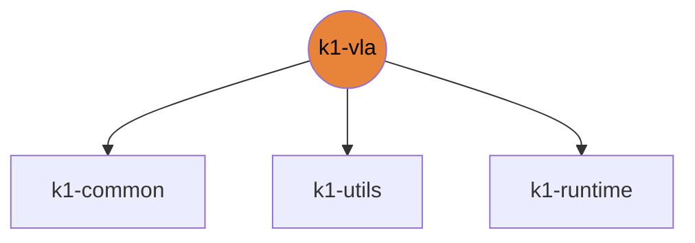

# k1-vla

k1_chat voice/VLM agent, tools and YOLO node.

| | |
|---|---|
| Layer | **L2**: Domain (no cross-imports) |
| May import | [k1-common](https://github.com/thdhyan/k1-common), [k1-utils](https://github.com/thdhyan/k1-utils), [k1-runtime](https://github.com/thdhyan/k1-runtime) |
| Files / LOC | 70 files · 5,976 lines (py, sh, cpp) |
| Part of | [k1-workspace](https://github.com/thdhyan/k1-workspace) (architecture and layering rules live there) |

## Where it sits



Used by: nothing (top layer).


## Install

```bash
uv add git+https://github.com/thdhyan/k1-vla
# or, from a checkout
uv sync
```

## Usage

`k1_chat`: voice and VLM agent with tool calls, plus a YOLO and depth service. It runs on the robot and is started
from the laptop.

```bash
bash scripts/demo.sh up      # STT on the laptop :8090, NAT, YOLO :8092 and agent + console :8091 on A1
bash scripts/demo.sh down    # [robot] [--all: also stops laptop STT]
```
- Console: http://192.168.50.82:8091/. Start every command with "Apollo". "Stop" always works.
- Runbook: [`docs/DEMO_RUNBOOK.md`](docs/DEMO_RUNBOOK.md). Access and fleet: `docs/ACCESS.md`, `docs/FLEET.md`.
- Fleet registry: `src/k1_chat/fleet.json` (package data).
- Tests: `pytest tests` (markers `robot`, `net`, `onprem` are deselected by default).

## Tests

From a k1-workspace checkout (see its README, "Run the tests"):
```bash
cd libs/k1-vla && python -m pytest -q tests
```

Default options: `-m 'not robot and not net and not onprem'`.
- marker `robot`: needs a live K1 (set K1_IP)
- marker `net`: needs internet / OpenRouter
- marker `onprem`: needs the self-hosted LLM server

## Robots and hosts

Robot IPs, SSH aliases, network, safety and how to control each robot: [docs/ROBOTS.md](https://github.com/thdhyan/k1-workspace/blob/main/docs/ROBOTS.md) in k1-workspace.

## Environment variables read

`K1_BACKEND`, `K1_CALL_NAME`, `K1_CHAT`, `K1_CHAT_API_KEY`, `K1_CHAT_ASR`, `K1_CHAT_BASE_URL`, `K1_CHAT_HOME`, `K1_CHAT_MIC_GAIN`, `K1_CHAT_MODEL`, `K1_CHAT_START_RMS`, `K1_DETECT`, `K1_DETECT_CUDA_MEM_LIMIT`, `K1_DETECT_HZ`, `K1_IP`, `K1_KOKORO_CUDA_MEM_LIMIT`, `K1_KOKORO_DEVICE`, `K1_KOKORO_LANG`, `K1_KOKORO_SPEED`, `K1_KOKORO_VOICE`, `K1_LAPTOP_IP`, `K1_NEMOTRON_LANG`, `K1_NEMOTRON_URL`, `K1_ROBOT_NAME`, `K1_VISION`, `K1_VISION_`, `K1_VISION_BASE_URL`, `K1_VISION_MODEL`, `K1_WAKE_WINDOW_S`, `K1_WAKE_WORDS`, `K1_WHISPER_MODEL`

## Layout

```
HANDOFF.md
PLAN.md
PLAN_TOOLS.md
README.md
docs/  (6 files)
  ACCESS.md
  AUDIO_PIPELINE.md
  DEMO_RUNBOOK.md
  FLEET.md
  README.md
  ssh_config.example
pyproject.toml
robot/  (1 files)
  run.sh
scripts/  (7 files)
  README.md
  demo.sh
  k1tools.sh
  k1voice.sh
  k1voice_install.sh
  probe_vl_tools.py
  serve_llm.sh
src/  (54 files)
  k1_chat/  (54 files)
tests/  (48 files)
  README.md
  fixtures/  (1 files)
  test_arbiter.py
  test_asr_adapter.py
  test_asr_server.py
  test_audio.py
  test_backend.py
  test_booster_robot.py
  test_brain.py
  test_console.py
  test_conversation.py
  test_conversation_tools.py
  test_debug.py
  test_events_safety.py
  test_fleet.py
  test_kokoro_mem_limit.py
  test_llm.py
  test_llm_panel.py
  test_llm_tools.py
  test_modes.py
  test_robot_tools.py
  test_script_tools.py
  test_tools.py
  test_vision.py
  test_wake.py
tools/  (1 files)
  depth_sbs_server.py
```

## Dependencies

- Declared sibling libraries: k1-common, k1-utils, k1-runtime (see `pyproject.toml`, `[tool.uv.sources]`).
- PyPI: httpx, numpy, onnxruntime, opencv-python, pytest, websockets.
- Provided by the environment (ROS 2, Isaac, mjlab, robot SDK) or unresolved: `dotenv`, `faster_whisper`, `geometry_msgs`, `kokoro_onnx`, `rclpy`, `respx`, `rosidl_runtime_py`, `sensor_msgs`, `std_msgs`, `ultralytics`.

## Hard-coded paths into other repos

These files still name paths that now live in another repo (hard-coded path strings, not imports). Pass them as arguments / config when you touch the file:

| File | Refers to | Owner |
|---|---|---|
| `PLAN.md` | `tools/` | k1-web-console |
| `PLAN_TOOLS.md` | `tools/` | k1-web-console |
| `docs/ACCESS.md` | `tools/` | k1-web-console |
| `docs/FLEET.md` | `tools/` | k1-web-console |

## Old `booster_ws` layout still referenced

These files still name `booster_ws`, `isaac_tasks/` or `booster_train_ref` paths (container scripts not ported yet, or docstrings):

- `HANDOFF.md`
- `PLAN.md`
- `PLAN_TOOLS.md`
- `docs/ACCESS.md`
- `docs/DEMO_RUNBOOK.md`
- `docs/FLEET.md`
- `src/k1_chat/backend.py`
- `src/k1_chat/frames.py`
- `tests/test_asr_adapter.py`

## Origin

Extracted from `booster_ws` (branch `dev/push-training-wip`, working tree of 2026-11-03; k1_chat from `wt-k1-tools`) by
`tools/build_workspace.py` in k1-workspace. Old path to new path for every file: [`docs/migration_map.tsv`](https://github.com/thdhyan/k1-workspace/blob/main/docs/migration_map.tsv) (filter on `k1-vla`).
History was not carried over: the working tree was copied as is, including previously untracked files.
